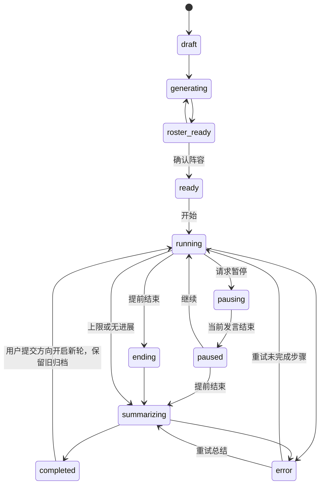
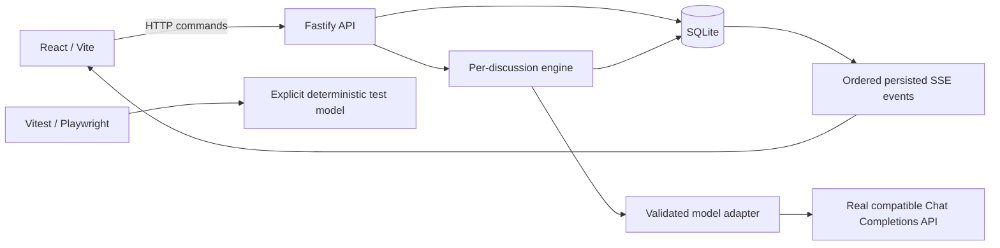

# AI Panel Studio · 产品与工程规格

本地单用户Web App。用户输入任意话题（1–2000字），指定2–6位虚构专家（默认4），自动生成主持人与阵容，确认后观看讨论。新建默认安全上限48次，可选96次；API支持6–120用于短回归与配置。用户可暂停/继续、结束、离开后返回，以及随时调整讨论焦点或明确替换前提。不包含语音、登录、联网检索、云部署。

## 页面和验收

按用户草图实现Codex式固定视口：左侧会话列表、搜索/筛选及随时新建；中央底部话题/方向输入区、专家人数与安全上限；中央大屏按人数动态渲染主持人和专家圆桌。节点用角色色标识，发言高亮、准备正常、待机暗淡，均有文字状态。点击打开可独立关闭和滚动的嘉宾窗，展示职业、Title、立场、公开关注点与该人历史消息。右侧共识/分歧可折叠且实时更新，下方简短总结固定区域，可展开完整条件与来源。现场记录另设视图，阅读历史不强制跟随；手机为侧栏/成果抽屉及中心内部滚动。Transcript仅正式发言与用户调整，不暴露举手、评分、JSON或隐藏推理。

主持人开场、追问、阶段推进、总结。每轮专家同时读取同一不可变版本并行提出举手、抢答、补充或反驳意向，调度选择1–2人，第二位读取第一位刚入库的消息；不能按名单循环。默认先展开至少各专家一个视角，至2×专家人数+2次后评估充分覆盖；收敛需全员已发言、连续两次有效判定且中间至少两次新发言，允许保留稳定分歧。连续3轮无进展且已达最少讨论量则收束；持续5轮停滞或完全无人参与也会收束。6次兼容回归保留短阶段策略。

48次档位还有25分钟活动时间和360次模型调用上限，96次为45分钟/720次；最早达到者结束，重试计入调用数，暂停/离线时间不累计。结束原因保存在endReason，预算边界不能称为自然达成一致。已知最少讨论量是防止过早停止的启发式，并不保证任何话题都能达成共识。

用户方向通过带UUID的幂等命令持久化。focus保留范围；replace移动当前证据边界、归档此前成果，旧消息不删除。directionVersion阻止旧意向、发言或分析结果落库，已有候选队列清空，主持人确认新方向；新版本至少获得相应新发言后再评估收敛。确认前换前提必须重新生成阵容；已结束或触及本轮上限时，方向输入开启新轮，summaryHistory保存上一轮总结及完整依据。

每次专家正式发言严格1–2句，后端校验超限后重试一次，仍失败则暂停，不截断原文。每条专家发言后更新共识/分歧。共识至少两位专家明确支持且没有未解决反对；关联正文引用由后端校验。最终自然语言总结覆盖结论、共识、分歧条件、下一步与待验证信息。不能把生成内容标记为事实核实。

## 状态机

重启时执行中的讨论转为暂停，保留待重试步骤。讨论任务由服务器独立推进，同场单任务，不同场隔离。

## 架构

SQLite 实体：Discussion、Participant、Message、Insight、DiscussionEvent，关联始终限定 discussionId。共享类型见 shared/types.ts。API 契约见 API.md。后端密钥仅通过环境变量注入；不发送到浏览器。

## 可靠性

模型结构验证/超时重试一次，仍失败则暂停并可重试，不静默降级到演示模型。持久化任务检查点避免重试跳过发言或共识更新。快照+单调序号事件恢复 SSE，客户端丢弃过期响应。用户话题及历史作为不可信数据，不能覆盖系统指令。React 文本渲染禁止执行 HTML。

全文保存于数据库；正式消息同事务更新带来源的条件、范围、时间证据记忆。压缩保护原题、证据、当前成果/未决分歧、被回应记录和最近两条消息，剩余空间装入普通历史；模型滚动摘要仅导航。按完整上下文JSON字符预算并预留角色/控制字段，保护材料本身超限则暂停，不静默删除。模型日志仅阶段、耗时、用量、错误类别，不记录key、完整请求或推理。

发言落库前执行确定性及模型一致性审查，冲突候选重写一次仍失败则暂停。总结只由模型选择实际发言ID，后端按验证后的共同判断、明确支持者、全部未决分歧及关键原句装配自然语言，不自由扩写全员一致。旧分歧须由相关方提供新的明确确认才能关闭，不能因模型省略而丢失。详见CONTEXT-REGRESSION.md。

工作区追加：共同判断发布前另核对每位来源对同一原子条件/阶段的支持。收束前和归档前逐ID复核关闭凭证，按各方自身最近引用与后续反对判断，主持人不计为支持者；原状态仍存事件。模型未复述的分歧ID不被删除，完整未关闭集合由数据库决定。将“已关闭”写入新的未决条目不会构成关闭，旧记录显示关闭提议待复核。最终逐项证据见WORKSPACE-ACCEPTANCE.md。

## 验收门槛

核心测试覆盖调度排序与防垄断、共识撤回、消息引用、状态边界、失败恢复、多场隔离、SSE 重连、重启恢复；E2E 覆盖创建→阵容→确认→运行→暂停/继续→总结→重开，以及窄屏布局。真实模型探测与真实示例生成独立执行，未配置时明确报告未验证。
