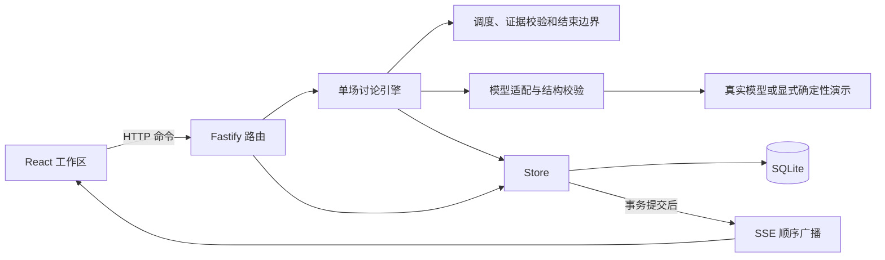

# 前后端架构与开发阶段

产品范围、角色、状态机和验收标准见 [PRD](SPEC.md)。

## 前端

| 入口或组件                              | 职责                                                                                     |
| --------------------------------------- | ---------------------------------------------------------------------------------------- |
| `App` / `ConversationSidebar`           | 用 hash 定位讨论。侧栏定时刷新列表，展示状态、专家人数、发言数、来源和完整更新时间。     |
| `Workspace` / `RoundTable`              | 处理建场、确认阵容、暂停和结束，显示圆桌与嘉宾状态。实时调整焦点和替换前提各有独立语义。 |
| `Transcript` / `GuestInspectors`        | 正式发言、用户方向调整与公开关注点。阅读历史时可停止跟随，支持跳回最新或定位引用。       |
| `DiscussionResults` / `DiscussionUsage` | 展示当前共识、分歧、待确认、关闭凭证、总结和 Token 用量。                                |
| `usePanel` 与 `api`                     | 快照后按游标订阅 SSE，丢弃重放的旧序号；写命令与快照分开。React 渲染文本。               |

桌面容器单独滚动。窄屏通过侧栏与成果抽屉保持中间区域可读。讨论关闭页面后仍由后端推进。

## 后端

Fastify 校验请求并把控制命令交给 Engine。同一场最多一个运行任务，模型适配器限制请求并发。专家并发提交参与意向，调度器每轮选择 1–2 位；正式发言串行生成，第二位可看到第一位刚提交的全文。主持人在开场、转换、停滞或结束时介入。服务端校验发言引用与长度，并独立审核成果证据。阶段、调度和持久化可用确定性模型测试，真实模型验收另留证据。

收束评估在满足最小讨论量后启动，发言数本身只打开评估。输出格式或引用错误时记录失败并继续；主持人的评估追问有次数上限。安全预算、达成覆盖、稳定分歧、停滞及用户结束分别记录。SQLite 事务与检查点见[数据库设计](DATA-DESIGN.md)，模型材料构造见[上下文设计](CONTEXT-DESIGN.md)。

## 实际 Git 演进

| 阶段               | 提交证据                                                                                        |
| ------------------ | ----------------------------------------------------------------------------------------------- |
| SDD 规格与共享契约 | `a8ab773` 定义产品、共享类型和阶段 Prompt。                                                     |
| 核心逻辑与首批测试 | `f89f290` 提交调度、持久化、模型契约和相应测试。                                                |
| DDD 页面与集成     | `393ab29` 提交响应式组件和首批 E2E。                                                            |
| 恢复与边界测试     | `a0a808a`、`08b186f` 验证恢复、模式隔离、句数和真实流程。                                       |
| 质量迭代           | `b580c13`、`87e775a` 修正证据保留和总结，`142da6a` 引入工作区方向调整，`9a79b82` 建立议题账本。 |
| 用量与结束评估     | `2eb8264`、`f1c870e` 增加请求缓存与实时用量；`2a4dcb7`、`e0f0407` 修正收敛触发与最新立场。      |
| 本地交付           | `89df5c2` 加入首组离线真实归档、完整时间与本地交付清单，后续提交扩展样例与文档。                |

首批测试与核心逻辑在同一提交，后续边界测试有独立提交。以 `git log --reverse --oneline` 查看实际顺序。
