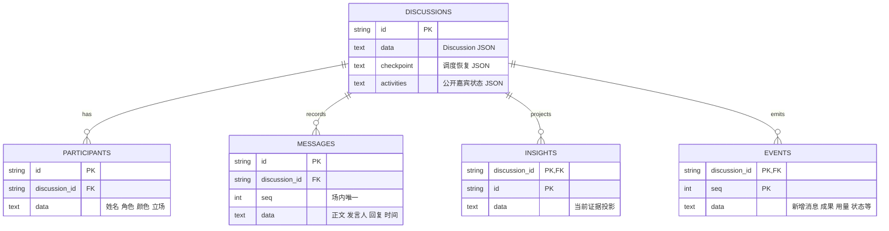
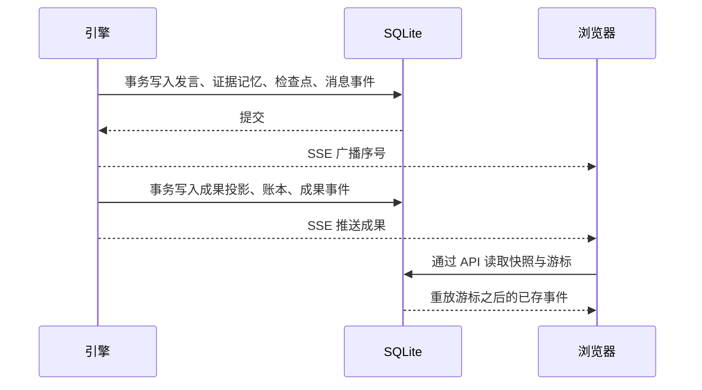

# SQLite 数据模型与会话保存

初始化入口为 `npm run db:init`。物理表定义和事务位于 `server/db.ts`，领域类型位于 `shared/types.ts`。SQLite 启用外键、WAL 和忙等待超时。

## 领域字段和存储边界

| 字段位置                         | 内容与约束                                                                                                                 |
| -------------------------------- | -------------------------------------------------------------------------------------------------------------------------- |
| `discussions.data`               | 原始话题、有效话题、焦点、方向版本、周期、停止原因、Token 用量和时间。主记录带当前总结、完整依据、历史总结及旧前提归档。   |
| `discussions.data.insightLedger` | 按稳定 ID 保存共识、分歧、待确认、关闭、合并及历史。引用保存消息 ID、专家 ID、序号和原话。归档前保留失效或撤回记录的历史。 |
| `messages.data`                  | 区分正式发言和用户方向调整。发言者、回复关系由业务层验证属于同一场，原文、序号和时间长期保存。                             |
| `insights`                       | 当前可发布的共识和开放分歧，关闭与待确认通过账本读取。                                                                     |
| `checkpoint`                     | 待消费的发言队列、待处理成果消息、无进展轮数、收束状态等。内部意向不会作为现场发言展示。                                   |

## 一次提交与会话恢复

暂停会保留未完成工作。成果分析失败后续跑时优先处理已提交发言的成果，避免生成重复发言。服务重启后把执行中的讨论恢复为暂停。已完成场次回看时直接读取快照；替换前提后开始新的证据边界，旧正文仍可查。历史复核在事务内保存旧总结和旧账本，再发布新结论。

离线示例以完成状态直接导入角色、正文、当前成果和历史凭证，保留原 ID 与时间。已有同 ID 行优先，种子不覆盖；运行私有数据库、日志和密钥不入包。模型用量只对上游实际返回的指标累计，不反推缺失数据。
