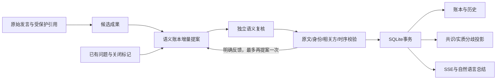

# 分歧与共识账本验收 · 2026-11-18

本次针对历史同义分歧重复、已确认记录滞留与共识少报进行修复。原始发言、历史结果和异常现场保留；结构检查与逐条语义审阅分别报告。

## 修复设计

原逻辑按结论文字生成ID：换一种措辞就成为新记录；完整列表覆盖会删除被模型遗漏的共识，保守保留又积累旧分歧。新版以稳定的中性原子问题作为身份，模型只提交增量操作，后端维护可追溯账本。

- 同问题沿用ID，分歧转共识也不换ID。语义合并必须显式指定旧ID，旧记录保存mergedInto墓碑和别名，不按模糊词自动合并启动、运行与退出条件。
- resolved保留关闭状态、原文、相关方及历史；旧反对不能复活关闭项，只有关闭后新的相关反对允许重开。
- 共识需要至少两位不同专家支持同一完整原子判断。后端核对真实消息、实际作者、逐字引用；独立review进一步检查语义、范围、阶段和条件。旁观context不计支持者。
- 未提及的共识和问题保留。无证据的复合结论可改为较小的真实共同点，避免一条附加条件不成立就漏掉全部共同点。
- question单列外部批准、真实负责人指定或数据验证；专家一致认为尚待批准，不应展示为专家彼此反对，也不表示已获用户批准。
- 关闭检查按该问题各方自己的最近有效立场，不拿无关问题的后续反对阻止关闭。旧版本未经验证的context引用不充当反对或确认依据。
- 完成后的复核把旧总结、旧成果和旧账本归档，与新投影和总结同事务保存；消息及完成事件不改写。

## 真实验证中发现并修正的问题

首次旧记录复核已提取4项共识，但部分旧项仍被无关后来引用卡住。修正后区分未经验证的context与实际同题立场。

新真实讨论在3次专家发言后暂停：一致性审查拒绝把负责人备案节点与回退失败复核节点混成同一节点的候选发言，没有将该候选落库。同时发现账本把“接受角色分离”当成“接受指定期限”的证据，补充独立ledger-grounding审核后，暂停检查点复核已撤下该期限共识，保留真正得到两人支持的角色分离判断。异常与恢复前快照独立保存，继续同一讨论，不重开掩盖失败。

结构通过不能证明任意自然语言无误；具体真实结果与原文审阅见本报告后续记录。

## 最终执行结果

| 检查           | 实际结果                                                                                                                            |
| -------------- | ----------------------------------------------------------------------------------------------------------------------------------- |
| 核心测试       | 89项，11个文件全部通过；含稳定ID、合并、旧引用、逐方时序、无效关闭、重新打开、原文保留、落库与历史总结刷新                          |
| 浏览器E2E      | 最终6/6通过，含已撤销候选不占有效关闭数、关闭双方原话、引用跳转及手机布局；曾有一次测试服务退出导致连接拒绝，冻结代码后完整重跑通过 |
| 生产构建       | TypeScript与Vite通过                                                                                                                |
| 压缩压力       | 40/180/600条历史 × 12,000/28,000字符预算，6组通过；600条原始消息832,487字符，12,000预算实际9,192字符，5条关键原句及未决分歧完整保留 |
| 真实保真读取   | 完整24条、压缩24条、压缩600条三个变体，4个问题的原句/原消息ID、未决分歧ID全部一致；故意错误摘要未覆盖原话                           |
| SQLite独立审计 | 旧修复与最终新场各16项检查通过：快照/表记录一致、原文及旧总结保留、唯一完成事件、关闭相关方与共识原文支持等                         |
| 实际页面       | Edge桌面1568×1003和手机390×844，原文与关闭依据可展开，无页面脚本错误或整体溢出                                                      |

### 旧记录修复

记录`e950f15d-2229-456a-bf2d-cf3a2194ba06`：修复前0条共识、12条未关闭历史分歧；当前5条已发布共同判断、0条开放分歧、3条外部待办、7条合并墓碑、3条有证据关闭的历史记录。3条关闭包括原有复合问题，不能视为3个彼此独立的新争议；5条共同判断也包含该复合表述，不按完全独立观点数宣传。

运行联系人门槛按原文#14/#15确认，退出责任人的阶段边界按#13/#14/#15确认；之后没有重新以未决分歧显示。维护工时阈值/频次、外部批准、真实人选指定保留为question，没有把缺少批准写成专家彼此反对。事实表字段的复合候选仍未通过独立复核，放入“证据待复核”，不为增加共识条数而发布。

21条原消息保留；独立审计发现导出的两处时间戳只是`.270Z`与`.27Z`的等价格式差异，按同一时刻归一后，消息字段与原文全部相同。原总结、各轮成果及账本均可追溯，最终累计7个总结历史版本；仍仅一个completed事件。历史复核使用原140调用安全预算，到上限没有继续调用；纯本地总结刷新不消耗模型调用。

### 最终新场真实回归与语义核对

记录`1f90169e-f3da-4083-ad63-b1502a89da8d`：2位虚构专家、9次正式发言、93次模型调用，endReason=converged，自然收束。最终2条共识、0条开放分歧、1条待外部确认事项，实际完成1次分歧转共识；26项自动检查全部通过，SQLite独立审计也通过。

| 判断                                                           | 原文与时间线核对                                                                                                                                                                                         |
| -------------------------------------------------------------- | -------------------------------------------------------------------------------------------------------------------------------------------------------------------------------------------------------- |
| 退出负责人启动前指定，退出时仅履职；人选待用户指定             | 沈砚舟#2提出启动前指定；周岚#5接受，#10明确退出决策时履职而非另设指定时点；#13/#14最终互认。未把指定人选当成已完成。                                                                                     |
| 运行联系人启动前确定含当班姓名和替补的名单，能力验收放试点记录 | 沈砚舟#7提出拆分名单与能力验收并坚持写入姓名；周岚#8修正为姓名/替补两栏；#9互认，#10明确撤回#5中“运行时确认当班人”的旧主张；#13/#14再确认。沿用issue-3b3126c36535620a，关闭序号9，之后没有重建同义分歧。 |
| 待办                                                           | 实际人选和后续4周评估批准仍待用户决定；不当作已生效安排或当前专家分歧。                                                                                                                                  |

本场在1次发言时因个人态度审查过严暂停，5次时因旧关闭字段契约失败暂停；现场分别保存在ledger-final-first-pause.json与ledger-final-legacy-protocol-pause.json。修复后恢复同一场，最后4次专家发言、账本和归档按最终代码完成；没有重新创建记录来掩盖失败。最终语义核对依据完整原文与#13/#14明确互认；原文#9有一处口头旧序号归属不准确，未改写原消息，也未以该错误序号替代数据库消息引用。

另一场开发中回归`3b05567d-11cb-4105-8aeb-158a8b063944`最终11次发言、140调用预算收束。曾确认后又被独立审查否定的复合候选，现不计有效关闭。其早期导出检查曾未排除verified=false，已保存原导出并更正最新passed=false；本场只作失败/恢复/预算证据，不替代上述9次自然收敛的最终关闭验收。

## 可复核证据与边界

- `evidence/ledger-real-final.json`：最终新场全量Snapshot、26项检查、运行模式与逐条语义复核。
- `evidence/ledger-repair-before.json`、`ledger-repair-after.json`：旧记录修复前后；中间各次结果另存，不把多轮复核写成一次通过。
- `evidence/ledger-archive-audit.json`：直接只读SQLite比对，关闭相关方与真实消息逐字核验。
- `evidence/ledger-context-real.json`：本轮6组压力和3个真实模型保真变体。
- `evidence/ledger-*-pause*.json`：未落库候选导致的暂停或协议失败现场；不含密钥或隐藏推理。

语义合并和支持判断仍由模型执行，可能保守少报或误判；未验证候选明确保留，本轮没有声称任意自然语言零误差。每次都要求额外重复确认会造成假性未决，已按“原提议+对方完整接受”确认，附加条件仍需独立核对。个人观点获准发言不等于正式共识获批。5场真实示例、指定工具过程证据和外部交付等完整作业限制仍见DELIVERY.md，本次不宣称全部交付条件完成。
