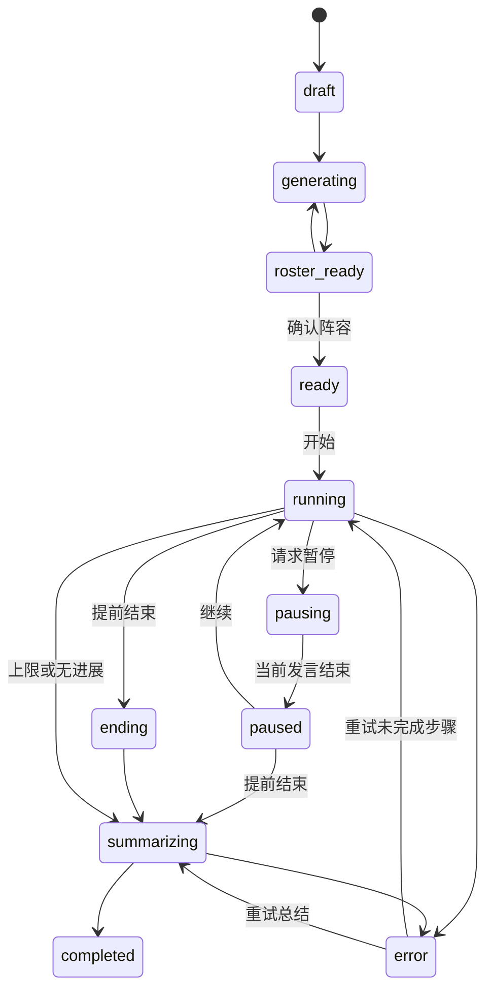
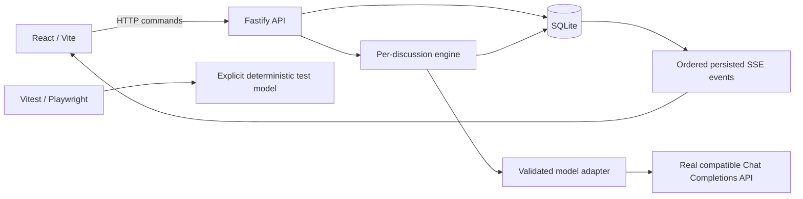

# AI Panel Studio · 产品与工程规格

本地单用户 Web App。用户输入任意话题（1–2000 字），指定 2–6 位虚构专家（默认 4）和 6–20 次专家发言（默认 12），生成主持人与阵容，确认后观看讨论。用户仅作观众，可暂停/继续、提前结束、离开后返回。不包含语音、用户插话、登录、联网检索、云部署。

## 页面和验收

首页显示全部讨论、状态、进度、时间，支持状态筛选。阵容确认显示姓名、职业、Title、立场、领域与角色色；整组重新生成失败保留原阵容，确认后不可修改。演播厅固定视口：嘉宾状态 / Transcript / 共识与分歧三栏各自滚动，手机页签切换。阅读历史时不强制跟随。Transcript 仅正式发言，不暴露举手、评分、JSON 或隐藏推理。

主持人开场、追问、阶段推进、总结。每轮专家独立申请，由调度器选择 1–2 人，按最新上下文串行发言；不能固定轮流。默认发言约三分之一、三分之二处推进阶段。连续两轮无有效参与则总结，到上限强制总结。

每条专家发言后更新共识/分歧。共识至少两位专家明确支持且没有未解决反对；关联正文引用由后端校验。最终自然语言总结覆盖结论、共识、分歧条件、下一步与待验证信息。不能把生成内容标记为事实核实。

## 状态机

重启时执行中的讨论转为暂停，保留待重试步骤。讨论任务由服务器独立推进，同场单任务，不同场隔离。

## 架构

SQLite 实体：Discussion、Participant、Message、Insight、DiscussionEvent，关联始终限定 discussionId。共享类型见 shared/types.ts。API 契约见 API.md。后端密钥仅通过环境变量注入；不发送到浏览器。

## 可靠性

模型结构验证/超时重试一次，仍失败则暂停并可重试，不静默降级到演示模型。持久化任务检查点避免重试跳过发言或共识更新。快照+单调序号事件恢复 SSE，客户端丢弃过期响应。用户话题及历史作为不可信数据，不能覆盖系统指令。React 文本渲染禁止执行 HTML。

全文保存于数据库；上下文预算不足时传入滚动摘要、近期发言、当前成果与引用消息。模型日志仅阶段、耗时、用量、错误类别，不记录 key、完整请求或推理。

## 验收门槛

核心测试覆盖调度排序与防垄断、共识撤回、消息引用、状态边界、失败恢复、多场隔离、SSE 重连、重启恢复；E2E 覆盖创建→阵容→确认→运行→暂停/继续→总结→重开，以及窄屏布局。真实模型探测与真实示例生成独立执行，未配置时明确报告未验证。
