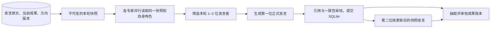

# 专家上下文、证据压缩与请求缓存

## 每一轮如何读写

专家上下文包含角色、职业、立场、关注领域和当前任务。讨论组共享话题、有效前提、焦点、正式发言、证据和未决议题。角色相同的完整信息已在阵容前缀时，动态任务只传角色 ID。并发参与意向看到同一版本，正式发言按顺序获取更新后的正文。方向版本变化后，旧任务结果不能写入当前讨论。

## 压缩取舍

| 顺序 | 处理                                                                                                      |
| ---- | --------------------------------------------------------------------------------------------------------- |
| 1    | 全量上下文可放入预算时，优先传递完整场内有效历史。                                                        |
| 2    | 超预算时固定保留原题、有效边界、角色、当前共识和未决分歧。最近两条消息保留全文。                          |
| 3    | 保护被引用发言、队列计划回应和范围、时间、条件原句。旧消息必要时附精确摘录，保留作者、序号和真实消息 ID。 |
| 4    | 有余量时补录普通历史。滚动摘要只提供导航；冲突时以发言原文为准。                                          |
| 5    | 保护材料本身超限时暂停并提示调整预算。数据库原文不受压缩影响。                                            |

`MODEL_CONTEXT_CHARS` 默认 56,000 字符，构造阶段预留 2,000 字符给角色、候选发言和控制参数，最终还检查合并后的输入。该值属于应用预算，实际计费依据供应商用量。条件抽取基于文本规则，模型的语义审核可能漏报。验收有 40/180/600 条合成压力测试和真实模型读取原句的对照。

## 请求组织和用量

`compact` 顺序为固定共享头、逐条追加的发言、动态账本、任务系统指令和本次参数。精简重复的讨论 ID、时间戳和传输诊断字段。保留原文、作者、顺序、证据与回复关系。可用 `prefix` 或 `legacy` 做对照。此处复用模型前缀缓存，专家仍独立生成响应。Token 报告由模型提供，存入当前讨论并通过 SSE 更新。

详见[长上下文回归](内容回归测试.md)、[真实缓存对照](紧凑上下文与最新立场设计.md)。小样本验证了关键条件与引用保真，不能保证任意主题、任意供应商的命中率。
