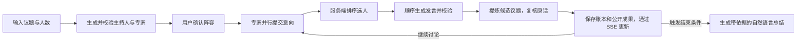

# 核心逻辑说明

模型负责生成角色、提出发言意向和判断语义。服务端负责决定谁发言、校验证据、维护议题状态以及提交数据库。主要入口为 [server/engine.ts](../server/engine.ts)，模型任务定义见 [server/prompts.ts](../server/prompts.ts)。

## 嘉宾生成

1. 创建讨论时校验话题和专家人数，可选 2–6 位，默认 4 位。生成任务读取有效议题、当前焦点和专家人数，让模型返回一位主持人和若干虚构专家，包括姓名、职业、Title、立场和关注点。
2. 后端先用 Zod 校验结构，再检查总人数等于专家数加一、主持人唯一且位于首位、全体姓名不重复。嘉宾 ID、所属讨论和角色颜色由程序分配。阵容与事件一起提交，前端收到更新后展示结果。
3. 用户确认后锁定阵容。重新生成失败时保留旧阵容，首次生成失败则回到草稿。生成期间如果讨论方向版本变化，旧结果不能写入。已替换前提的过期阵容需重新生成后再确认。

实现入口为 `Engine.generate`、`Engine.confirm` 和 [rosterSchema](../server/schemas.ts)。

## 发言调度

- **同一版本并行征询。** 每轮由主持人开场或承接当前方向，然后向专家并行发送同一份讨论快照及各自角色。专家可以不参与，也可以申请举手、抢答、补充或反驳，返回回应对象、紧迫程度和可公开的理由。对证据摘录的引用先还原到原消息 ID，再校验它是否属于当前上下文。
- **服务端排序。** [selectSpeakers](../server/scheduler.ts) 过滤无意发言或不属于本场的角色。依次考虑上一条消息直接点名、讨论已发言数至少达到专家数后仍未发言的专家、回应现有分歧、补充或反驳、距上次发言的间隔、最近 8 条专家发言中的频次、模型给出的紧迫程度。相同条件按角色 ID 稳定排序。有其他候选时避开刚发言者，每轮最多选两人，并受剩余发言预算限制。
- **正式发言串行提交。** 候选队列写入检查点。正式发言重新读取最新上下文，因此同轮第二位能看到第一位刚提交的发言。专家发言须为 1–2 句，并校验回复对象和内容一致性。范围、时间线或成果归因冲突会触发纠正，持续不合规则暂停；已落库的消息可从检查点继续处理成果。方向版本可阻止旧任务提交。
- **讨论结束独立判定。** 发言达到评估门槛后，系统检查参与覆盖、待推进问题和稳定分歧。仍可推进时允许主持人定向追问。发言、时间、调用上限和停滞独立生效，归档保留实际结束原因。

## 共识提炼

1. **提取候选。** 每条专家发言提交后，`updateInsights` 基于当前有效证据边界提取共识及分歧候选。`reviewLedger` 结合已知议题、历史证据和新候选提出状态更新。独立的语义审核同时检查候选和已发布结论，判断引文是否支持同一条件、同一阶段，以及原立场是否已被撤回。
2. **程序核验。** [applyLedger](../server/insight-ledger.ts) 将引用映射到实际消息和作者，要求逐字引文存在且来自本场有效范围内的专家。共识至少需要两位不同专家明确支持，且没有对应直接反对。实质分歧需要反对证据和至少两位相关专家的立场，未获证据或批准的提议可保留为待确认。无法通过审核的结论可进入待复核，原证据仍留在历史。
3. **管理议题生命周期。** 账本以稳定 ID 维护议题。相同议题可沿用 ID，合并时保留旧 ID 和历史。关闭已验证分歧需要覆盖相关专家的有效确认或撤回，且证据时序不能落后于该专家的既有立场。待确认转为共识不会计为关闭分歧。新反对需晚于关闭凭证才能触发重开。
4. **发布与总结。** 当前成果由已核验账本投影，和检查点、SSE 事件一起写入 SQLite。归档总结由 [summary.ts](../server/summary.ts) 依据成果、结束原因及原话装配。用户可回查引用，外部数据、实验结果和授权仍需另外验证。

例如在[知识库试点真实样例](../server/examples/knowledge-base-pilot.json)中，周岚在第 10 条发言撤回原先的当班人确认时点，第 13、14 条记录了双方对新口径的确认。归档关闭了关于联系名单的争议，实际人选和后续评估批准仍列为待确认。

代码验收覆盖 [阵容生成与恢复](../tests/engine.test.ts)、[发言排序](../tests/scheduler.test.ts)、[共识与分歧账本](../tests/insight-ledger.test.ts)和[浏览器交互](../tests/e2e/panel.spec.ts)。
